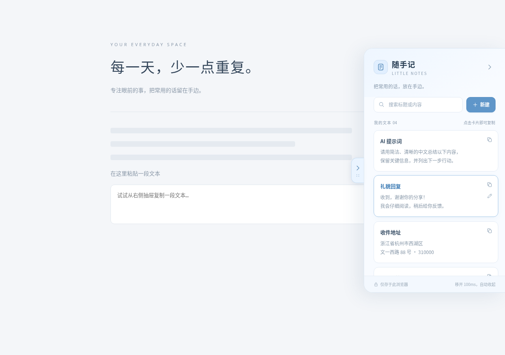

# 随手记 · 文本抽屉

一个轻巧的 Chrome / Edge 扩展，把常用文本放在浏览器右侧。浅蓝色界面，无后端、无运行时依赖。



## 安装

先把仓库克隆到本地：

```bash
git clone https://github.com/panpan749/chrome_note.git
```

1. Chrome 打开 `chrome://extensions`（Edge 打开 `edge://extensions`）。
2. 打开右上角的「开发者模式」。
3. 点击「加载已解压的扩展程序」，选择仓库里的 **`chrome_note/extension` 文件夹**。该目录已包含完整插件，不需要安装 Node.js、依赖或执行构建。
4. 打开任意普通网页。安装前已打开的页面需要刷新。

### 后续更新

在本地仓库目录执行：

```bash
git pull --ff-only
```

然后在扩展管理页找到「随手记」，点击「重新加载」（圆形箭头），再刷新使用插件的网页，就能看到更新。不需要删除或重新安装扩展，已保存的文本会保留。请始终加载同一个 `extension` 目录；Git 拉取代码本身不会让已运行的插件自动热更新。

如果使用 ZIP 安装包，解压后加载直接包含 `manifest.json` 的文件夹；建议采用上面的 Git 方式，方便后续更新。

## 使用

- **展开**：鼠标悬停右侧贴边的小箭头，或点击扩展工具栏图标。
- **定位**：按住箭头上下拖动。位置会记住，并在标签页之间同步。
- **复制**：点击任意文本卡片，复制完整原文，保留换行和空格。复制成功会出现绿色勾选反馈。
- **收起**：浏览列表时，鼠标移开抽屉超过 100ms 自动收起，期间移回会取消收起。新建、编辑文本期间保持展开，搜索框输入时也不会因鼠标移开而收起；可随时点右上角箭头或按 `Esc` 手动收起。
- **管理**：点击「新建」添加标题和正文；卡片悬停时出现编辑按钮，编辑页支持修改、删除，删除需要二次确认。
- **查找**：搜索标题或正文，多条文本可以滚动浏览。
- **键盘**：聚焦把手后按 `Enter` 展开；把手支持上下方向键定位；编辑时 `Ctrl / ⌘ + Enter` 保存。

首次安装没有预设文本。截图中的条目仅是测试示例。收起不会清空当前编辑框，重新展开可以继续写；未保存的草稿在刷新或关闭网页后会丢失。

文本使用 `chrome.storage.local` 保存，多个网页共享同一份本地数据，不发送到服务器，也不跨设备同步。卸载扩展会清除数据。

Chrome 内部页面、扩展商店等浏览器受保护页面不允许注入抽屉；普通 HTTP / HTTPS 网页可用。只在顶层网页展示，避免 iframe 重复显示。推荐使用近期版本的 Chrome / Edge。

## 开发与验证

需要 Node.js 20 或更新版本。扩展使用 Manifest V3；原生 JavaScript + CSS，Shadow DOM 隔离网页样式。

```bash
npm ci
npm run check
npm run build
npx playwright install chromium
npm test
```

测试在独立浏览器配置目录中加载真实扩展，验证悬停、100ms 延迟、编辑防误收起、拖动、剪贴板原文、多标签页同步、增删改、持久化、搜索、滚动和样式隔离，并生成 `docs/drawer.png` 与 `docs/collapsed.png`。不会读取日常使用的浏览器配置或个人数据。

也可指定支持扩展调试的独立 Chrome 可执行文件：

```bash
CHROMIUM_PATH=/path/to/chrome npm test
```

本云环境的系统 Chromium 禁止加载开发者扩展，因此测试使用 Google 官方下载的独立 Chrome，未改动系统浏览器策略。云环境安装步骤：

```bash
bash scripts/setup-cloud.sh
CHROMIUM_PATH=/workspace/.chrome-note-tools/chrome/opt/google/chrome/chrome npm test
```

源文件位于 `src/`，`scripts/build.mjs` 将样式内嵌到内容脚本并生成可加载的 `extension/`。修改源码后执行 `npm run build`，将生成的 `extension/` 与源码一起提交，确保使用者拉取后即可重新加载。构建不需要启动服务。
